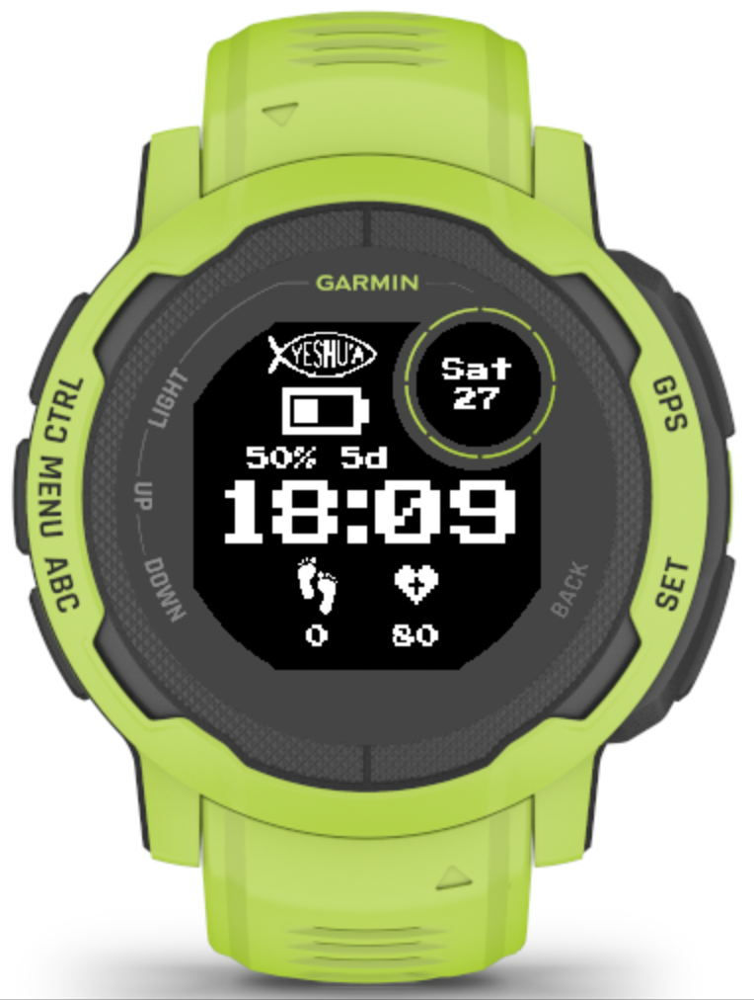

# Garmin Instinct 2 Retro Watch Face

A custom watch face for the Garmin Instinct 2, featuring a retro pixel-art aesthetic.

## Preview



## Features

- **Retro Pixel Design**: chunky bitmap fonts and 1-bit pixel-art icons.
- **Time**: large digits that follow the watch's 12/24-hour setting.
- **Date**: day and date centered in the round subscreen.
- **Battery**: pixel battery whose fill matches the exact charge, with percentage and estimated days remaining. A bolt appears while charging.
- **Steps**: daily count (`12.3K` from 10,000 steps) with a 10-segment meter that fills toward your step goal.
- **Heart Rate**: live reading when available, otherwise the latest valid sample; `--` when the watch is off-wrist.
- **Phone Status**: a crossed-phone icon appears when the phone is disconnected.
- **Yeshua Fish Icon**: custom decorative element.

## Device Support

- Garmin Instinct 2

## Development

This project is built using the Garmin Connect IQ SDK (API level 3.4.0 or later). The SDK tools need a Java 17+ runtime.

### Build

```sh
monkeyc -f monkey.jungle -d instinct2 -o bin/RetroInstinct.prg -y /path/to/developer_key
```

### Unit Tests

The pure formatting logic in `source/RetroFormat.mc` is covered by Run No Evil tests in `source/RetroFormatTests.mc`. Tests are excluded from regular builds.

```sh
monkeyc -f monkey.jungle -d instinct2 -o bin/RetroInstinctTest.prg -y /path/to/developer_key -t
connectiq &
monkeydo bin/RetroInstinctTest.prg instinct2 -t
```
